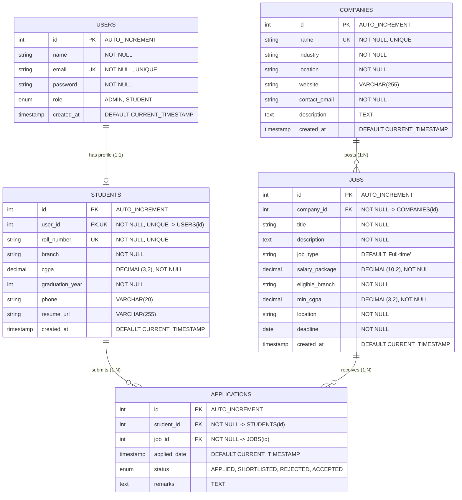

# NEXUS - Entity Relationship Diagram

### Cardinality Summary
- **USERS to STUDENTS**: `1 : 0..1` (One-to-One / Optional for ADMIN users). Every student profile corresponds to exactly one user account with role `STUDENT`.
- **COMPANIES to JOBS**: `1 : N` (One-to-Many). One company can publish zero or many job listings.
- **STUDENTS to JOBS (via APPLICATIONS)**: `M : N` (Many-to-Many resolved by the associative `APPLICATIONS` entity).
  - A student can submit multiple applications (`1 : N`).
  - A job can receive applications from multiple students (`1 : N`).
  - Constraint: `UNIQUE(student_id, job_id)` prevents a student from applying to the same job multiple times.
